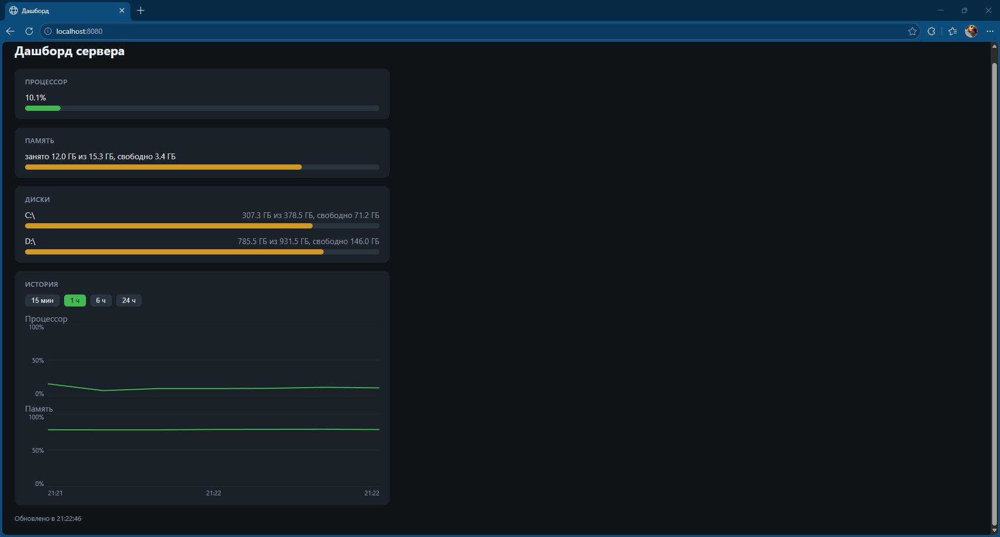

# Server Dashboard

Лёгкий self-hosted дашборд для мониторинга домашнего сервера: загрузка CPU, память, диски и история метрик с графиками. Написан на Rust, собирается и деплоится автоматически при каждом пуше.



## Возможности

- Текущие метрики сервера: CPU, оперативная память, диски
- История метрик в SQLite — запись каждые 3 секунды, графики на странице
- Автоочистка истории старше 7 дней
- JSON API: `GET /api/metrics`
- Один Docker-контейнер, без внешних зависимостей

## Стек

| Часть | Технологии |
|---|---|
| Бэкенд | Rust, [axum](https://github.com/tokio-rs/axum), [sysinfo](https://github.com/GuillaumeGomez/sysinfo), tokio |
| Хранение | SQLite |
| Фронтенд | Одна HTML-страница, графики на JS |
| Сборка | Docker, multi-stage + [cargo-chef](https://github.com/LukeMathWalker/cargo-chef) для кэширования зависимостей |
| CI/CD | Forgejo Actions (self-hosted), Forgejo Container Registry, systemd timer |

## Как устроен деплой

```
git push ──► Forgejo ──► Forgejo Runner (docker-in-docker)
                              │
                              ├─ docker build (cargo-chef кэширует зависимости)
                              └─ docker push ──► Forgejo Container Registry
                                                         │
          сервер: systemd timer раз в минуту ◄───────────┘
          docker pull → если образ обновился, контейнер перезапускается
```

Сервер сам забирает новый образ из registry, поэтому CI не нужен доступ к `docker.sock` хоста. Пайплайн лежит в `.forgejo/workflows/`, секреты (токен registry) хранятся в настройках Forgejo, а не в коде.

## Запуск

Локально:

```bash
cargo run --release
```

В Docker:

```bash
docker build -t dashboard .
docker run -d --name dashboard -p 8080:8080 dashboard   # порт поправить под тот, что в main.rs
```

Затем открыть `http://localhost:8080`.

## Планы

- [ ] Показывать реальные диски хоста изнутри контейнера
- [ ] Свой образ раннера с предустановленным Docker CLI, чтобы ускорить CI
